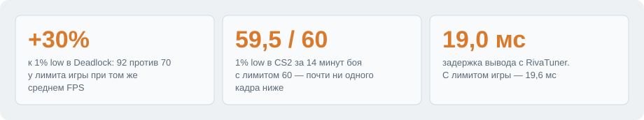
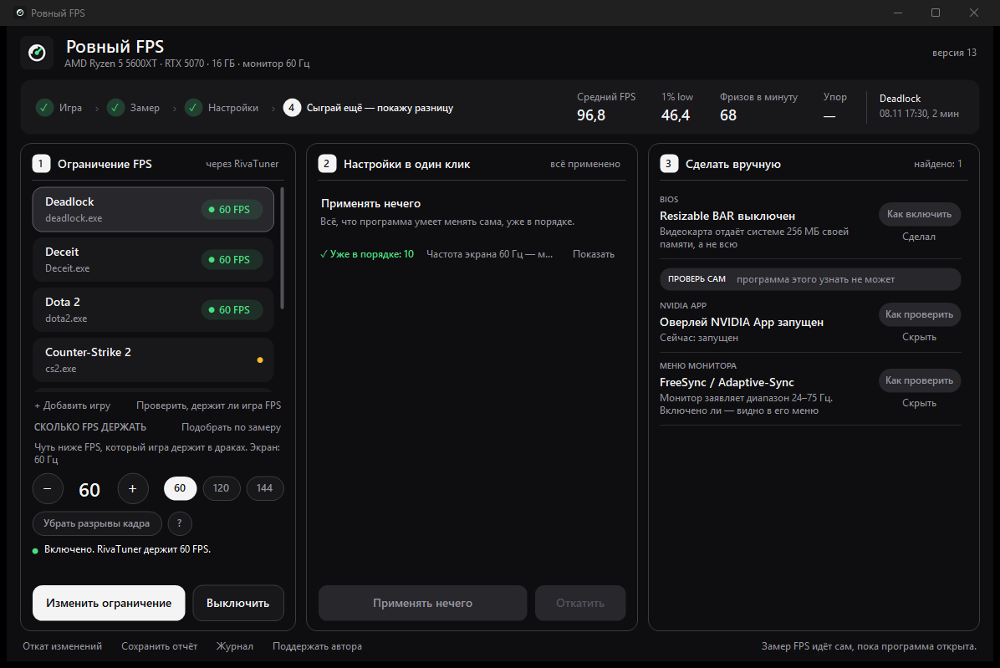
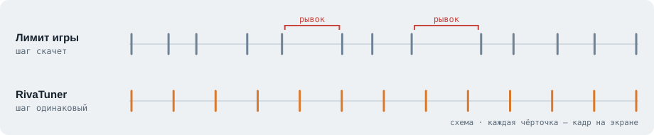
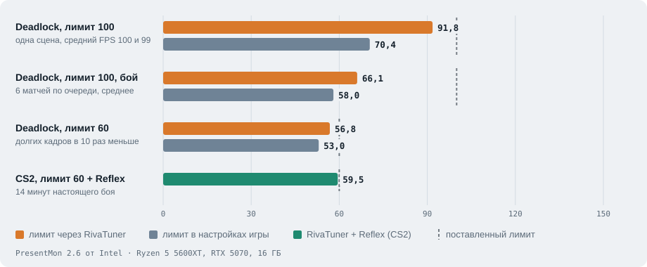

# Ровный FPS

Выбираешь игру, жмёшь «Включить», и игра держит ровные кадры без рывков.
С версии 13 в той же программе есть оптимизатор: он находит, что режет FPS на твоём компьютере, и исправляет одной кнопкой. Любое изменение можно откатить.

<picture>
  <source media="(prefers-color-scheme: dark)" srcset="docs/plitki-dark.svg">
  
</picture>



**[▶ Ролик: Deadlock без лимита и с программой](docs/rolik.mp4)** (15 с). Без лимита FPS за бой скачет от 91 до 153, с программой держится 98–100.

**[Скачать RovnyFPS.exe](https://github.com/mrraketa/rovny-fps/raw/main/RovnyFPS.exe)** (около 420 КБ, Windows 10/11, установка не нужна)

## Что в окне

1. **Ограничение FPS** (слева). Лимит кадров через RivaTuner: выбрал игру, нажал «Включить». Игру перезапускать не нужно.
2. **Настройки в один клик** (посередине). Программа проверяет компьютер и показывает только то, что правда мешает:
   запись Xbox в фоне, обслуживание Windows, которое будит компьютер, экономию энергии видеокарты в игре и другое.
   «Применить все без риска» исправляет всё безопасное сразу. Перед каждым изменением сохраняется точка отката.
3. **Сделать вручную** (справа). То, что программа сама поменять не может: Resizable BAR в BIOS, FreeSync в меню монитора и так далее.
   К каждому пункту есть подсказка, где это включается.

Сверху — четыре шага «что сделать сейчас» и цифры последнего матча: средний FPS, 1% low и фризы в минуту.
Сыграл ещё матч — программа покажет разницу.

Питание видеокарты в игре программа настраивает только на видеокартах NVIDIA. Ограничение FPS работает на любых.

## Как работает ограничение FPS

<picture>
  <source media="(prefers-color-scheme: dark)" srcset="docs/skhema-dark.svg">
  
</picture>

Картинка дёргается не из-за низкого среднего FPS, а из-за редких медленных кадров (1% low).
RivaTuner выпускает кадры с одинаковым шагом, поэтому игра ощущается плавнее при том же FPS.

Программа сама находит игры из Steam, Epic, GOG, EA, Ubisoft, Battle.net и Riot.
Не знаешь, какое число ставить, — «Подобрать по замеру»: PresentMon от Intel меряет игру и ставит лимит чуть ниже того, что она держит.

## Замеры

<picture>
  <source media="(prefers-color-scheme: dark)" srcset="docs/zamery-dark.svg">
  
</picture>

При том же среднем FPS самые медленные кадры у RivaTuner почти на треть быстрее.
В настоящем бою разница меньше, но стабильная: за 6 матчей Deadlock (режимы по очереди)
1% low выше на 14%, рывков почти вдвое меньше. Каждый матч с RivaTuner прошёл ровнее любого матча с лимитом игры.
В CS2 за 14 минут боя с лимитом 60 почти ни один кадр не опустился ниже лимита.
А против `fps_max` в CS2 (6 матчей, лимит 100) средний FPS одинаковый, но с RivaTuner кадры идут ровно каждые 10 мс,
а с лимитом игры в каждой секунде боя есть кадр около 15 мс — на 50% длиннее
(на графике это 98 против 66 FPS: худший кадр обычной секунды, пересчитанный в FPS).

<details><summary>Таблица: Deadlock, лимит 100, одна сцена</summary>

| Как ограничен FPS | Средний FPS | 1% low | 0,1% low |
|---|---|---|---|
| RivaTuner (эта программа) | 100 | **92** | **86** |
| Лимит в настройках игры | 99 | 70 | 64 |

</details>

<details><summary>Таблица: Deadlock, лимит 100, настоящий бой, 6 матчей</summary>

Матчи шли по очереди: RivaTuner, лимит игры, RivaTuner… Считаются только секунды в бою, без меню и загрузок.

| Как ограничен FPS | 1% low по матчам | В среднем | Рывков в минуту | В среднем |
|---|---|---|---|---|
| RivaTuner (эта программа) | 70,5 · 64,6 · 63,2 | **66** | 15 · 25 · 33 | **24** |
| Лимит в настройках игры | 58,4 · 58,5 · 57,0 | 58 | 31 · 46 · 45 | 41 |

</details>

<details><summary>Таблица: CS2, лимит 100, Бой насмерть, 6 матчей</summary>

Матчи шли по очереди. Лимит игры — `+fps_max 100` в параметрах запуска, Reflex в игре включён.
Считаются только секунды в бою без переключения на другие окна. При лимите 100 идеальный шаг кадра — 10 мс.

| Как ограничен FPS | Средний FPS | Самый долгий кадр в обычную секунду | Секунд с кадром дольше 12 мс | Дольше 20 мс |
|---|---|---|---|---|
| RivaTuner (эта программа) | 98–99 | **10,2 · 10,3 · 10,2 мс** | **22% · 38% · 21%** | **2,3%** |
| Лимит в настройках игры | 98 | 15,2 · 15,3 · 15,1 мс | 100% · 100% · 100% | 5,0% |

</details>

## Частые вопросы

<details><summary><b>Добавляет задержку?</b></summary>

Нет. Вывод на экран — 19,0 мс с RivaTuner и 19,6 мс с лимитом игры.
</details>
<details><summary><b>Какой лимит ставить?</b></summary>

Чуть ниже FPS, который игра держит в боях. Или «Подобрать по замеру» — меряй в бою, а не в меню.
</details>
<details><summary><b>Оптимизатор что-то сломает?</b></summary>

Перед каждым изменением программа сохраняет точку отката, а «Откат изменений» внизу окна возвращает всё как было.
Пункты с риском помечены отдельно, и программа спросит перед ними. В BIOS и в меню монитора программа ничего не меняет, только подсказывает.
</details>
<details><summary><b>У меня была версия 10 — что делать?</b></summary>

Ничего: в окне появится кнопка «Обновить». Лимиты, которые ты уже включил, остаются.
</details>
<details><summary><b>Windows пишет «защитила компьютер»</b></summary>

У программы нет платной подписи. «Подробнее» → «Выполнить в любом случае». Код открыт.
</details>
<details><summary><b>Антивирус убрал файл в карантин</b></summary>

Это ложное срабатывание. Антивирусу не нравится набор действий, которые программа делает по делу: сама скачивает обновление, создаёт задание автозапуска для RivaTuner, меняет настройки Windows и просит права администратора. Подписи у файла нет, поэтому он выглядит подозрительно.
Что делать: верни файл из карантина и добавь его в исключения. Сверить, что файл тот самый, можно по SHA-256 из [versiya.txt](versiya.txt). Код открыт, программу можно собрать самому (`build.bat`).
Напиши в [Issues](https://github.com/mrraketa/rovny-fps/issues), какой антивирус ругается, и мы отправим им жалобу на ложное срабатывание.
</details>

## Откуда идея

Идея и настройки для CS2 взяты из ролика канала Pqqip Production
[«КС2 дёргается, хотя FPS 400?»](https://www.youtube.com/watch?v=EHgBdsNGjvM)
и [поста на Reddit](https://www.reddit.com/r/cs2/comments/1j5cncf/found_a_fix_for_bad_1_and_01_lows/).
Программа делает то же самое одной кнопкой и для любой игры.

## Что нужно

- **RivaTuner Statistics Server** — бесплатный. Если его нет, программа предложит поставить
  его сама (через winget, официальный пакет Guru3D) и без твоего «Да» ничего не скачает.
- Права администратора: RivaTuner лежит в Program Files, а настройки Windows без них не поменять.

## Что программа меняет

- Профиль игры в RivaTuner (лимит кадров) и автозапуск RivaTuner — задание «RovnyFPS - RivaTuner» в планировщике.
  Когда выключаешь последнюю игру, задание удаляется.
- Только то, что ты применил в «Настройках в один клик»: параметры Windows, фоновые программы и профиль игры в драйвере NVIDIA.
  Всё записано в точки отката и возвращается кнопкой.
- Только для CS2: параметры запуска в Steam из ролика (`-high`, `-noreflex`, `+fps_max 0` и др.)
  и лимит через NVIDIA Reflex. Для этого Steam ненадолго закрывается и открывается снова.
  Старые параметры запоминаются и возвращаются при «Выключить».
- PresentMon (если согласился), сырые данные замеров и журнал — в `%LOCALAPPDATA%`.

Если в игре включена вертикальная синхронизация (VSync), лимит может не заметить разницы —
VSync сам держит FPS на частоте монитора. Выключи её в настройках игры.

## Обновления

Когда выходит новая версия, в окне появляется кнопка «Обновить». Программа скачивает новый
exe отсюда, сверяет контрольную сумму SHA-256 и перезапускается.

## Поддержать

Программа бесплатная и такой останется. Если она сэкономила тебе вечер с настройками,
можно закинуть на развитие: **[boosty.to/raketo4ka](https://boosty.to/raketo4ka/donate)**.
Пиши в [Issues](https://github.com/mrraketa/rovny-fps/issues), что сломалось и чего не хватает.

## Собрать самому

Нужен только Windows: компилятор C# входит в .NET Framework 4.x.

```bat
build.bat
```

Получится `RovnyFPS.exe` рядом. Слева в окне — прежний «Ровный FPS» (`rovny\`), посередине и справа — оптимизатор (`master\`).

## Лицензия

[MIT](LICENSE). Значок — «gauge» из набора [Tabler Icons](https://tabler.io/icons) (MIT).
RivaTuner Statistics Server — программа Guru3D, сюда не входит и ставится с их сервера.
