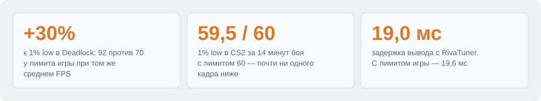
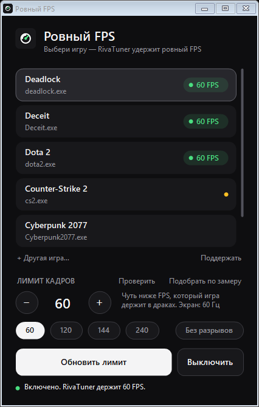
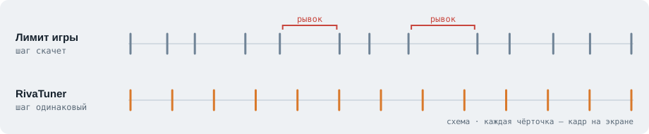
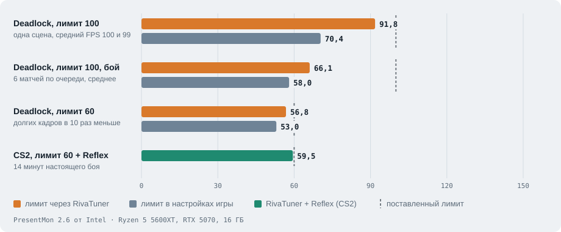

# Ровный FPS

Выбираешь игру, жмёшь «Включить», и игра держит ровные кадры без рывков.
Лимит ставит RivaTuner: программа сама его настраивает, сам ты в нём ничего не трогаешь.

<picture>
  <source media="(prefers-color-scheme: dark)" srcset="docs/plitki-dark.svg">
  
</picture>



**[▶ Ролик: Deadlock без лимита и с программой](docs/rolik.mp4)** (15 с) — без лимита FPS скачет от 91 до 153, с программой держится 98–100.

**[Скачать RovnyFPS.exe](https://github.com/mrraketa/rovny-fps/raw/main/RovnyFPS.exe)** (215 КБ, Windows 10/11, установка не нужна)

## Как это работает

<picture>
  <source media="(prefers-color-scheme: dark)" srcset="docs/skhema-dark.svg">
  
</picture>

Картинка дёргается не из-за низкого среднего FPS, а из-за редких медленных кадров (1% low).
RivaTuner выпускает кадры с одинаковым шагом, поэтому игра ощущается плавнее при том же FPS.

1. **Выбираешь игру.** Список из Steam, Epic, GOG, EA, Ubisoft, Battle.net и Riot программа находит сама.
2. **Жмёшь «Включить».** Программа пишет профиль RivaTuner. Игру перезапускать не нужно.
3. **Не знаешь лимит** — «Подобрать по замеру»: PresentMon от Intel меряет игру и ставит лимит чуть ниже того, что она держит.

## Замеры

<picture>
  <source media="(prefers-color-scheme: dark)" srcset="docs/zamery-dark.svg">
  
</picture>

При том же среднем FPS самые медленные кадры у RivaTuner почти на треть быстрее.
В настоящем бою разница меньше, но стабильная: за 6 матчей Deadlock (режимы по очереди)
1% low выше на 14%, рывков почти вдвое меньше. Каждый матч с RivaTuner прошёл ровнее любого матча с лимитом игры.
В CS2 за 14 минут боя с лимитом 60 почти ни один кадр не опустился ниже лимита.
А против `fps_max` в CS2 (6 матчей, лимит 100) средний FPS одинаковый, но с RivaTuner кадры идут ровно каждые 10 мс,
а с лимитом игры в каждой секунде боя есть кадр около 15 мс — на 50% длиннее
(на графике это 98 против 66 FPS: худший кадр обычной секунды, пересчитанный в FPS).

<details><summary>Таблица: Deadlock, лимит 100, одна сцена</summary>

| Как ограничен FPS | Средний FPS | 1% low | 0,1% low |
|---|---|---|---|
| RivaTuner (эта программа) | 100 | **92** | **86** |
| Лимит в настройках игры | 99 | 70 | 64 |

</details>

<details><summary>Таблица: Deadlock, лимит 100, настоящий бой, 6 матчей</summary>

Матчи шли по очереди: RivaTuner, лимит игры, RivaTuner… Считаются только секунды в бою, без меню и загрузок.

| Как ограничен FPS | 1% low по матчам | В среднем | Рывков в минуту | В среднем |
|---|---|---|---|---|
| RivaTuner (эта программа) | 70,5 · 64,6 · 63,2 | **66** | 15 · 25 · 33 | **24** |
| Лимит в настройках игры | 58,4 · 58,5 · 57,0 | 58 | 31 · 46 · 45 | 41 |

</details>

<details><summary>Таблица: CS2, лимит 100, Бой насмерть, 6 матчей</summary>

Матчи шли по очереди. Лимит игры — `+fps_max 100` в параметрах запуска, Reflex в игре включён.
Считаются только секунды в бою без переключения на другие окна. При лимите 100 идеальный шаг кадра — 10 мс.

| Как ограничен FPS | Средний FPS | Самый долгий кадр в обычную секунду | Секунд с кадром дольше 12 мс | Дольше 20 мс |
|---|---|---|---|---|
| RivaTuner (эта программа) | 98–99 | **10,2 · 10,3 · 10,2 мс** | **22% · 38% · 21%** | **2,3%** |
| Лимит в настройках игры | 98 | 15,2 · 15,3 · 15,1 мс | 100% · 100% · 100% | 5,0% |

</details>

## Частые вопросы

<details><summary><b>Добавляет задержку?</b></summary>

Нет. Вывод на экран — 19,0 мс с RivaTuner и 19,6 мс с лимитом игры.
</details>
<details><summary><b>Какой лимит ставить?</b></summary>

Чуть ниже FPS, который игра держит в боях. Или «Подобрать по замеру» — меряй в бою, а не в меню.
</details>
<details><summary><b>Надо перезапускать игру?</b></summary>

Нет, лимит меняется на ходу. Кроме CS2: там меняются параметры запуска в Steam.
</details>
<details><summary><b>Нагружает компьютер?</b></summary>

Почти нет: «Замер в игре» берёт около 0,2% процессора и 25 МБ памяти.
</details>
<details><summary><b>Что такое «Замер в игре»?</b></summary>

Включаешь один раз — каждая катка мерится в фоне. После игры видно, где проседал FPS (в бою, в меню или в альт-табе) и из-за чего: видеокарта, процессор, память или диск.
</details>
<details><summary><b>Windows пишет «защитила компьютер»</b></summary>

У программы нет платной подписи. «Подробнее» → «Выполнить в любом случае». Код открыт.
</details>
<details><summary><b>Антивирус убрал файл в карантин</b></summary>

Это ложное срабатывание. Антивирусу не нравится набор действий, которые программа делает по делу: сама скачивает обновление, создаёт задание автозапуска для RivaTuner и просит права администратора. Подписи у файла нет, поэтому он выглядит подозрительно.
Что делать: верни файл из карантина и добавь его в исключения. Сверить, что файл тот самый, можно по SHA-256 из [versiya.txt](versiya.txt). Код открыт, программу можно собрать самому (`build.bat`).
Напиши в [Issues](https://github.com/mrraketa/rovny-fps/issues), какой антивирус ругается, и мы отправим им жалобу на ложное срабатывание.
</details>
<details><summary><b>Как обновлять?</b></summary>

В окне сама появится кнопка «Обновить».
</details>

## Откуда идея

Идея и настройки для CS2 взяты из ролика канала Pqqip Production
[«КС2 дёргается, хотя FPS 400?»](https://www.youtube.com/watch?v=EHgBdsNGjvM)
и [поста на Reddit](https://www.reddit.com/r/cs2/comments/1j5cncf/found_a_fix_for_bad_1_and_01_lows/).
Программа делает то же самое одной кнопкой и для любой игры.

## Что нужно

- **RivaTuner Statistics Server** — бесплатный. Если его нет, программа предложит поставить
  его сама (через winget, официальный пакет Guru3D) и без твоего «Да» ничего не скачает.
- Права администратора: RivaTuner лежит в Program Files, без них настройки не записать.

При первом запуске Windows может показать «Система Windows защитила ваш компьютер».
Это потому, что у программы нет платной подписи. Нажми «Подробнее» → «Выполнить в любом случае».
Исходный код весь здесь, его можно посмотреть и собрать самому.

## Как пользоваться

1. Запусти. Программа найдёт игры из Steam, Epic, GOG, EA, Ubisoft, Battle.net и Riot.
   Нет в списке — «+ Другая игра…» и выбери exe.
2. Выбери игру и лимит. Подсказка: чуть ниже FPS, который игра держит в драках.
   На мониторе 60 Гц ставь 60.
3. «Включить». Чтобы вернуть как было — «Выключить». Лимит меняется на ходу,
   игру перезапускать не нужно (кроме CS2 — там меняются параметры запуска Steam).

Не знаешь, какое число ставить, — нажми **«Подобрать по замеру»** и поиграй 4 минуты.
Программа замерит игру без лимита, поставит лимит чуть ниже твоего 1% low и замерит ещё раз.
Внизу окна останется «было / стало». **«Проверить»** замеряет число, которое ты выбрал сам,
и скажет, держит ли его компьютер.

**«Замер в игре»** — включаешь один раз, и каждая катка мерится в фоне. После выхода из игры
внизу окна и в «Журнале» видно, где проседал FPS: в бою, в меню, в альт-табе или пока впереди
было окно на другом мониторе, какие кадры были самыми долгими и что их задержало
(видеокарта, процессор, нехватка памяти, чтение с диска или заминка в самой игре).

Замер делает бесплатная [PresentMon](https://github.com/GameTechDev/PresentMon) от Intel (MIT):
она видит кадры сама, а не через RivaTuner. При первом замере программа предложит её скачать
(около 1 МБ, с GitHub) и проверит контрольную сумму. Откажешься — замер пойдёт через RivaTuner,
но с его лимитом он выглядит ровнее, чем есть.

**«Без разрывов»** — для мониторов без G-Sync/FreeSync. Если при повороте камеры видна
горизонтальная полоса, где картинка «сдвинута», включи. RivaTuner будет выводить кадры под частоту
экрана так, чтобы полоса пряталась у нижнего края (режим Scanline Sync). Игре нужен запас FPS
выше частоты монитора. Высоту полосы мы подбирали на мониторе 60 Гц; на другом экране она может
оказаться чуть выше. Цена: FPS станет равен частоте экрана, а если игра просядет ниже, рывок будет
заметнее. Кнопка **«?»** рядом показывает, как выглядит кадр с разрывом и без, и что изменится у тебя.

## Что программа меняет

- Профиль игры в RivaTuner (лимит кадров).
- Автозапуск RivaTuner при входе в Windows — задание «RovnyFPS - RivaTuner» в планировщике.
  Когда выключаешь последнюю игру, задание удаляется.
- Только для CS2: параметры запуска в Steam из ролика (`-high`, `-noreflex`, `+fps_max 0` и др.)
  и лимит через NVIDIA Reflex. Для этого Steam ненадолго закрывается и открывается снова.
  Старые параметры запоминаются и возвращаются при «Выключить».
- PresentMon (если согласился) и сырые данные замеров — в `%LOCALAPPDATA%\RovnyFPS`.

Если в игре включена вертикальная синхронизация (VSync), лимит может не заметить разницы —
VSync сам держит FPS на частоте монитора. Выключи её в настройках игры.

## Обновления

Когда выходит новая версия, в окне появляется кнопка «Обновить». Программа скачивает новый
exe отсюда, сверяет контрольную сумму SHA-256 и перезапускается.

## Поддержать

Программа бесплатная и такой останется. Если она сэкономила тебе вечер с настройками,
можно закинуть на развитие: **[boosty.to/raketo4ka](https://boosty.to/raketo4ka/donate)**.
Пиши в [Issues](https://github.com/mrraketa/rovny-fps/issues), что сломалось и чего не хватает.

## Собрать самому

Нужен только Windows: компилятор C# входит в .NET Framework 4.x.

```bat
build.bat
```

Получится `RovnyFPS.exe` рядом.

## Лицензия

[MIT](LICENSE). Значок — «gauge» из набора [Tabler Icons](https://tabler.io/icons) (MIT).
RivaTuner Statistics Server — программа Guru3D, сюда не входит и ставится с их сервера.
